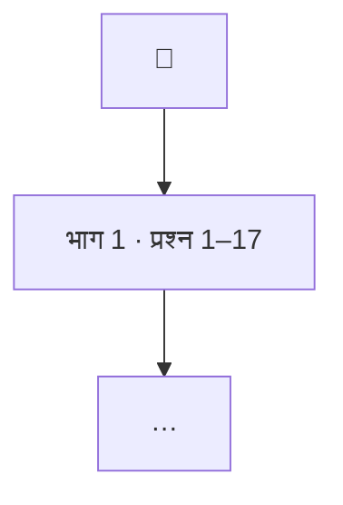

# Obsidian output spec

Load the `obsidian-markdown` skill for the syntax reference (wikilinks, callouts, frontmatter,
embeds, highlights, comments). This file defines the *shape* of the solutions note so every
paper produces a predictable, linkable file.

## 1. File layout

```
---
<frontmatter>
---

# <H1 title>

> [!abstract]- विषय-सूची (Table of Contents)      ← foldable, wikilink per section
> - [[#उत्तर कुंजी (Answer Key)]] — सभी N उत्तर, एक नज़र में
> - [[#विस्तृत हल (प्रश्न 1–17)]]
> - [[#स्रोत (Sources)]]
> - [[#पुनरावृत्ति चेकलिस्ट (Revision Tracker)]]

> [!abstract] परीक्षा विवरण
> <institute • paper code • pages • questions • option pattern>

> [!info] इस हल-पुस्तिका के बारे में
> <scan-page-by-page + web-verified + two-method maths note>



## उत्तर कुंजी (Answer Key)

> [!tip] उत्तर कुंजी का उपयोग कैसे करें
> <click guidance>

| प्रश्न | उत्तर | प्रश्न | उत्तर | … |
|---|---|---|---|---|
| 1 | [[#प्रश्न 1\|**D**]] | 25 | [[#प्रश्न 25\|**D**]] | … |

> [!note] आँकड़े — कुल प्रश्न: **120** • उत्तर भरे गए: **120** • शेष: **कोई नहीं**

---

## विस्तृत हल (प्रश्न 1–17)

**विषय-टैग:** #rajasthan-history #rajasthan-geography

### प्रश्न 1
**प्रश्न:** … (verbatim, all options)

> [!success] उत्तर: (D) उपरोक्त सभी

**व्याख्या:**
- … (source domain in parentheses)

> [!warning]- अन्य विकल्प क्यों गलत
> - **(A)** — …

---
```

## 2. Callout mapping (what `assemble.py` generates)

| Content | Syntax | Why |
|---|---|---|
| Answer | `> [!success] उत्तर: (X) …` | green, instant scan |
| Explanations, statements, question text | plain Markdown | long-form readability (no callout padding) |
| "why other options are wrong" | `> [!warning]- अन्य विकल्प क्यों गलत` | folded: hides noise until needed |
| Second maths method | `> [!tip] सत्यापन (विधि 2)` | "verification" colour, always visible |
| Question-level caveat / misprint | `> [!note] नोट` | neutral |
| Paper metadata, TOC | `> [!abstract]` | top-of-note scaffolding |
| Sources | `> [!cite]` (alias of `quote`) | grey, citation feel |
| Hidden build note | `%% … %%` | invisible in reading view |

## 3. Wikilinks — the whole point

- Answer key: `[[#प्रश्न 48\|**C**]]` — inside a table the alias pipe **must** be escaped,
  otherwise the cell splits.
- TOC: `[[#विस्तृत हल (प्रश्न 48–67) — गणित]]` — parentheses are fine; the text must match the
  heading exactly (case and punctuation included).
- Cross-paper links (same vault): `[[other-paper-solutions#प्रश्न 12]]`.
- Never rename a heading after generating links; run `validate.py` to prove they resolve.
- External sources use normal Markdown links `[label](https://…)` — wikilinks are for notes.

## 4. Tags and properties

- Frontmatter `tags`: exam family, subject, year — plus nested tags like `prashn-patr/hal`.
- Per-section inline tags on one line under the section heading: `**विषय-टैग:** #maths #reasoning`.
- Per-question tags are noise; keep them at section level.

## 5. Extras that pay off

- `- [ ]` revision checklist at the end (one item per section) — becomes a live tracker.
- `==highlight==` for the single most important fact in a question (sparingly).
- `$…$` / `$$…$$` for real maths (numbers, ratios, formulas) when the notation is non-trivial.
- `![[page-scan.png#page=3]]` if the user wants the original page embedded next to a disputed
  question — keep the PDF in the vault for that.

## 6. Plain copy

`assemble.py` also writes `<output>.bak.txt`: frontmatter and callout markers stripped,
wikilinks flattened to their display text, `%%` comments removed. It is the "no-Obsidian"
version of the same content — useful for printing or for pasting into a non-Obsidian editor.
